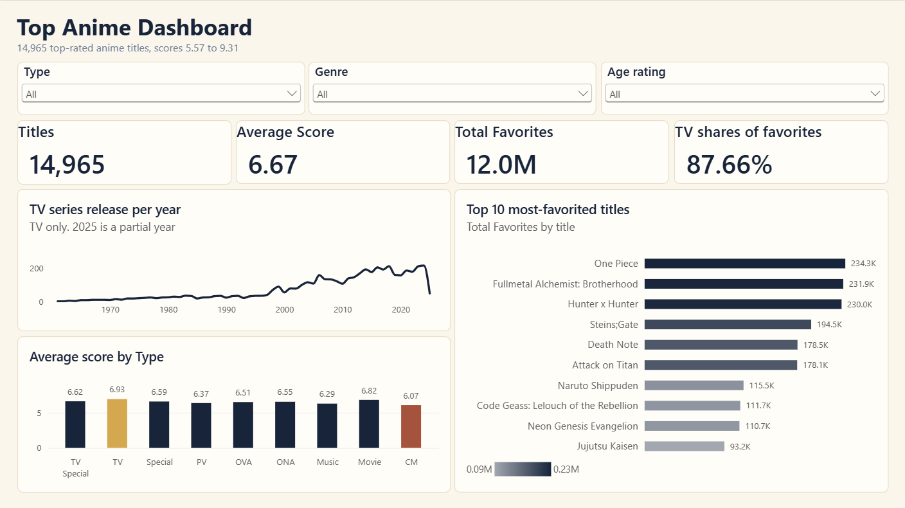
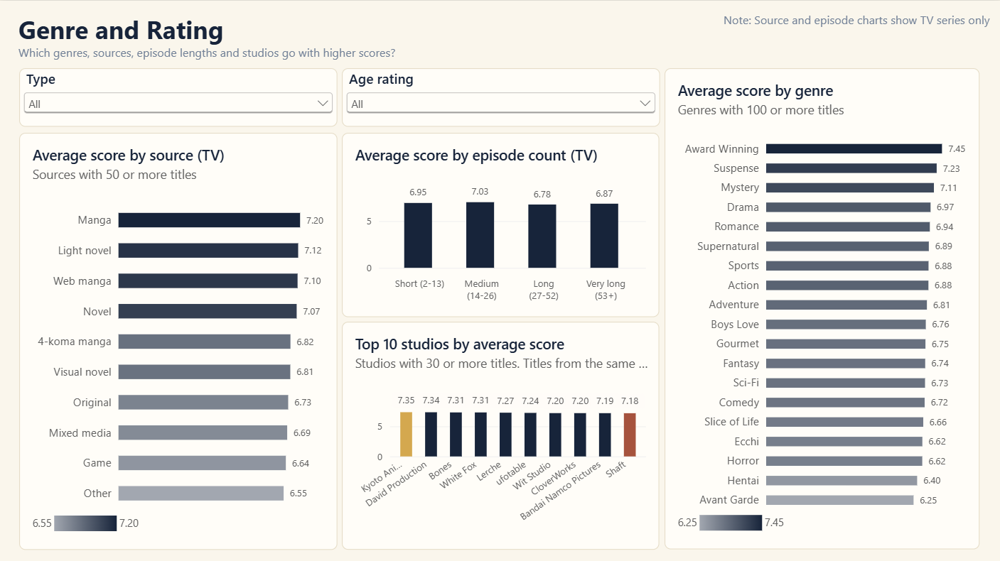
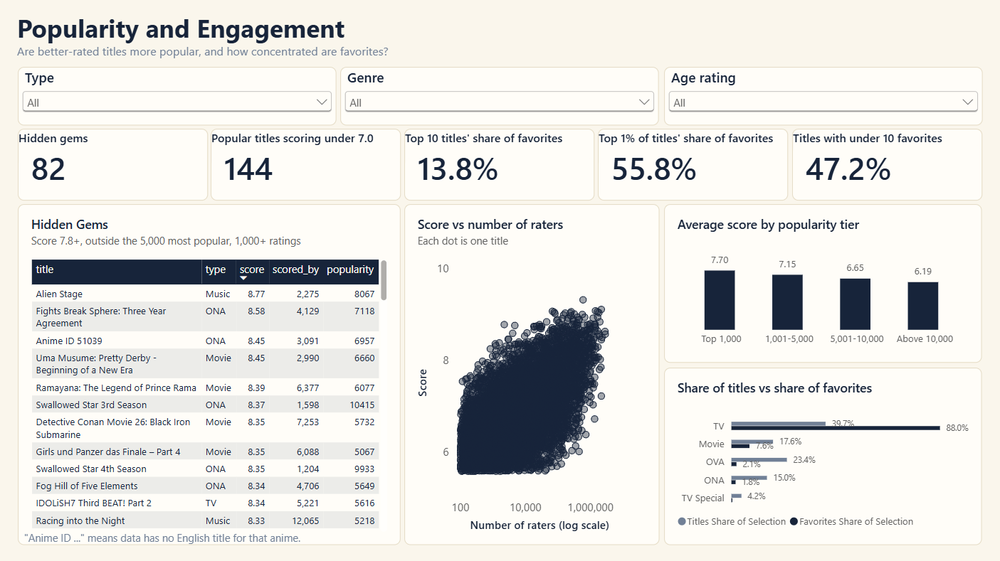

# Top Anime Analysis: Ratings, Popularity and Audience Attachment

End-to-end data analysis of 15,000 top-rated anime titles. Data cleaning and exploratory analysis in **Python**, then a 3-page interactive **Power BI** dashboard.

## Contents

- [Business problem](#business-problem)
- [Business questions](#business-questions)
- [Data](#data)
- [Tools](#tools)
- [Method](#method)
- [Key findings](#key-findings)
- [Recommendations](#recommendations)
- [Dashboard](#dashboard)
- [Limitations](#limitations)
- [Repository structure](#repository-structure)
- [How to reproduce](#how-to-reproduce)
- [Skills demonstrated](#skills-demonstrated)
- [Contact](#Contact)

## Business problem

A content team at a streaming platform or production company has to decide which kinds of anime are worth licensing, commissioning or promoting. Two signals matter: how well a title is **rated** (`score`) and how strongly fans are **attached** to it (`favorites`). This project asks which kinds of anime (type, genre, length, studio) tend to do well on those signals, and how far the data can be trusted.

## Business questions

1. **Audience attachment:** Which titles have the most favorites, and how concentrated is attachment in a small number of titles?
2. **Format and time:** Does the average score differ by anime type, and how has the number of titles released changed over time?
3. **Genre:** Which genres tend to have the highest average score, and how much does genre matter compared with differences between individual titles?
4. **Quality vs popularity:** Are the better-rated titles also the more popular ones, or is popularity a different thing from quality?
5. **What goes with higher scores:** Which studios, source materials and episode lengths are associated with higher scores?

## Data

- **Source:** `top_anime_dataset.csv`, 15,000 rows and 17 columns. [https://www.kaggle.com/datasets/quanthan/top-15000-ranked-anime-dataset-update-to-32025]
- **Audience size:** there is no `members` column, so `scored_by` (number of users who rated a title) is used instead.
- **Release year:** `premiered` exists for TV series only, so release-year analysis covers TV series only.

Key columns created in the notebook:

| Column | Meaning |
|---|---|
| `title` | English name, or `Anime ID <id>` when the source has no English name |
| `year`, `season` | Extracted from `premiered` (TV only) |
| `duration_min` | Episode duration in minutes, parsed from text |
| `genre_count`, `main_studio` | Number of genres, first listed studio |
| `episode_category`, `score_category`, `popularity_category` | Grouped versions, with `*_order` columns for sorting in Power BI |
| `favorites_per_1k_ratings` | Favorites relative to audience size |

Genres are stored in a second file, `anime_genres.csv` (one row per title and genre), because a title can have several genres.

## Tools

Python (pandas, NumPy, Matplotlib) in Jupyter, and Power BI (DAX measures, a many-to-many genre table, synced slicers, a custom theme).

## Method

1. **Business understanding and data inspection:** structure, types, ranges.
2. **Data quality assessment:** missing values, duplicates, inconsistent labels, outliers. Missing release dates are structural (only TV series have them), not random, so they were kept as blanks.
3. **Cleaning and preparation:** removed duplicates, labeled missing categories "Unknown", extracted year and season, parsed duration, split genres into their own table, and validated the result with assertions.
4. **Feature engineering:** genre count, main studio, episode, score and popularity categories, favorites per 1,000 ratings.
5. **EDA and simple statistics:** distributions, mean vs median, Spearman correlation, and group comparisons using medians and overlap. Averages use a minimum sample size: 100 titles for genres, 50 for sources, 30 for studios.
6. **Dashboard:** the cleaned files feed Power BI, and the dashboard figures were reconciled against the Python output.

## Key findings

- **TV series carry the audience.** TV is 31.5% of titles but holds 87.7% of all favorites, and has the highest average score (6.93, against 6.82 for Movie).
- **Attachment is concentrated.** The top 1% of titles hold 55.8% of favorites, and 47.2% of titles have fewer than 10.
- **Popular mostly means well rated, but not always.** Average score falls from 7.70 for the 1,000 most popular titles to 6.19 for titles outside the top 10,000. Still, 144 of those 994 most popular titles score below 7.0.
- **Genre matters less than expected.** Award Winning (7.45), Suspense (7.23) and Mystery (7.11) lead among genres with 100+ titles, but the gap between genres is small compared with the gap between individual titles.
- **Source and length.** Manga (7.20) and light novel (7.12) adaptations score above original anime (6.73). Among TV series, 14-26 episodes score highest (7.03); a longer series is not a better-rated one.
- **82 "hidden gems"** (score 7.8 or higher, outside the 5,000 most popular, at least 1,000 ratings) form a starting list for a licensing review.

## Recommendations

1. **Prioritise TV series when the goal is audience attachment.** They hold most of the favorites; series of 14-26 episodes score best.
2. **Look at manga and light novel adaptations first.** They score about 0.4 to 0.5 points above original titles.
3. **Use genre as a secondary filter.** A good title in any genre matters more than the genre itself.
4. **Do not judge by popularity alone.** Review the hidden-gems shortlist alongside the popular titles.
5. **Plan for a hit-driven catalogue.** A small number of titles hold most of the favorites, so focus marketing on titles with real fan attachment.

## Dashboard

The dashboard has three pages.

| Page | Answers | Preview |
|---|---|---|
| **Overview** | Headline numbers, score by type, TV releases per year, top 10 most-favorited titles |  |
| **Genre and Rating** | Genre, source, episode length and studio vs score |  |
| **Popularity and Engagement** | Quality vs popularity, concentration of favorites, hidden gems |  |

## Limitations

- Release years cover TV series only, and 2025 is a partial year.
- Sequels and seasons of one franchise are separate rows, so rows are not independent.
- Results show associations, not causes. Thresholds (popularity tiers, hidden gems, minimum sample sizes) are analyst choices.
- About 44% of titles have no English name and appear as "Anime ID ..." in the dashboard.

## Repository structure

```
anime-analytics-portfolio/
  README.md
  .gitignore
  Analysis/
    data/
      top_anime_dataset.csv        original file, never modified
      anime_cleaned.csv            output of the notebook
      anime_genres.csv             output of the notebook
    Top_Anime_Analysis.ipynb
  dashboard/
    Anime_Dashboard.pbix
    anime_theme.json
    PowerBI_Build_Guide.md
    screenshots/
      01_overview.png
      02_genre_rating.png
      03_popularity_engagement.png
```

## How to reproduce

1. Clone or download the repository.
2. Put `top_anime_dataset.csv` in the same folder as the notebook (or change the path in the first data-loading cell).
3. Run `notebooks/Top_Anime_Analysis.ipynb` from top to bottom. It recreates `anime_cleaned.csv` and `anime_genres.csv`.
4. Open `dashboard/Anime_Dashboard.pbix` in Power BI Desktop (Windows). If the data source path is wrong, use **Home, Transform data, Data source settings, Change source**, then **Refresh**.

## Skills demonstrated

Data cleaning and validation, handling structural missing data, outlier assessment, exploratory analysis, feature engineering, many-to-many data modeling, DAX measures (including conditional colors and minimum sample sizes), dashboard design, and honest reporting of limitations.

## Contact
Mail: nd.duykhoa@gmail.com
Linkedin: https://www.linkedin.com/in/khoa-nguyen-38076b365/
